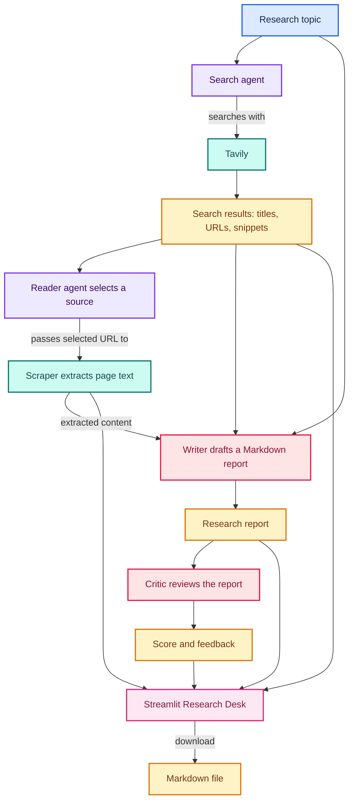

# Agentic AI Miniproject


The featured project is a multi-agent research assistant that searches the web, reads a relevant source, drafts a research report, and critiques the result. It includes both a Streamlit interface and a command-line entry point.

## Featured Project: Multi-Agent Research Assistant

The assistant uses specialized stages to turn a topic into a sourced report:

1. **Search**: Tavily finds relevant web pages and returns titles, URLs, and snippets.
2. **Read**: a reader agent selects a result and extracts page content.
3. **Write**: an OpenAI model drafts a structured report from the search results and extracted content.
4. **Review**: a critic evaluates the report and returns a score, strengths, and suggested improvements.

The Streamlit interface displays the report, critique, source links, search results, and extracted content. Reports can be downloaded as Markdown. Mathematical expressions are rendered when formatted as Markdown LaTeX.

### How the Pipeline Flows



The source list comes from Tavily's results. The reader's selected URL is marked in the UI even if the site blocks scraping; in that case, the search result remains available as a source.

### Agentic vs. Deterministic

**Agentic behavior** comes from the search and reader agents. The search agent decides how to use web search for the topic, and the reader agent chooses a promising URL and decides when to call the scraping tool. These choices are made by an LLM, so results can vary between runs.

**Deterministic orchestration** is handled by the Python pipeline: it runs search, reading, report drafting, and critique in a fixed order, passes each stage's output to the next, and stores the results. Tavily search, URL scraping, and the Streamlit display are explicit tool or application code; their returned data can still vary with external websites and services.

The writer and critic are prompt-to-LLM chains rather than tool-using agents. Their text is also model-generated and therefore not strictly deterministic.

## Quick Start

### Requirements

- Python 3.11
- Conda, `venv`, or another Python environment manager
- An OpenAI API key
- A Tavily API key

### Install

From the repository root:

```bash
cd langchain_multi_agent_research_assistant
conda create -n langagent python=3.11 -y
conda activate langagent
python -m pip install -r requirements.txt
```

If you already created and activated the `langagent` environment, skip the environment creation commands.

### Configure API Keys

Create a `.env` file in `langchain_multi_agent_research_assistant/`:

```dotenv
OPENAI_API_KEY=your_openai_api_key
TAVILY_API_KEY=your_tavily_api_key
```

Keep the real keys private. Do not commit `.env` or paste API keys into source code, issues, or logs.

### Run the Streamlit App

From `langchain_multi_agent_research_assistant/` with the environment activated:

```bash
streamlit run app.py
```

Open the local URL printed by Streamlit, enter a research topic, and select **Run research**.

### Run the Command-Line Pipeline

The command-line entry point runs the sample topic in `main.py`:

```bash
python main.py
```

## Project Structure

```text
.
├── langchain_multi_agent_research_assistant/
│   ├── app.py                         # Streamlit research interface
│   ├── main.py                        # Command-line pipeline entry point
│   ├── requirements.txt
│   └── src/
│       ├── agents/                    # Search, reader, writer, and critic components
│       ├── pipeline/                  # Orchestrates the research stages
│       └── tools/                     # Tavily search and page extraction tools
├── langchain_agent_practice/          # LangChain agent examples
├── langgraph_marathon/                # LangGraph and LCEL notebooks and demos
└── asyncio_practice/                  # Python async practice
```

## Notes and Limitations

- Search and model calls require valid API credentials and may incur provider usage costs.
- Some websites block automated requests or return `403 Forbidden`. Search results and source links can still be shown even when a page cannot be scraped.
- The report is generated from retrieved material. Review source links and verify important claims before relying on or republishing the report.
- `langchain_multi_agent_research_assistant/requirements.txt` contains the dependencies for the featured project; install them from that project directory.

## Contributing

Contributions are welcome. Open an issue to discuss a bug or proposed change, or submit a pull request with a focused description of the change. Do not include API keys, `.env` files, virtual environments, or other secrets in commits.

## License

This repository does not currently include a `LICENSE` file. Until a license is added, no reuse or redistribution rights should be assumed.